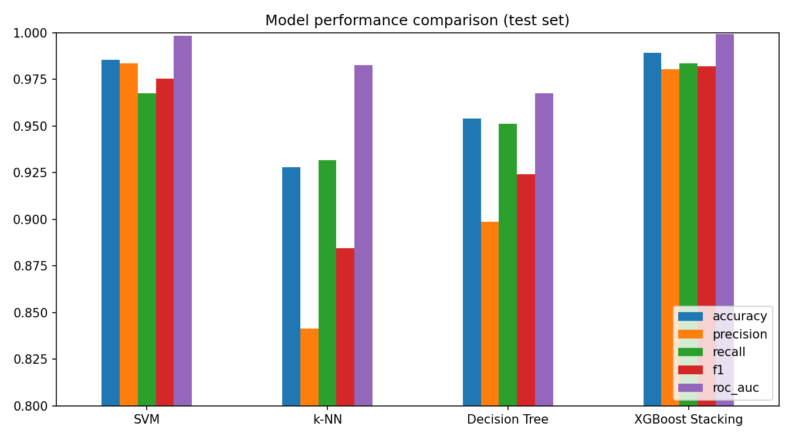
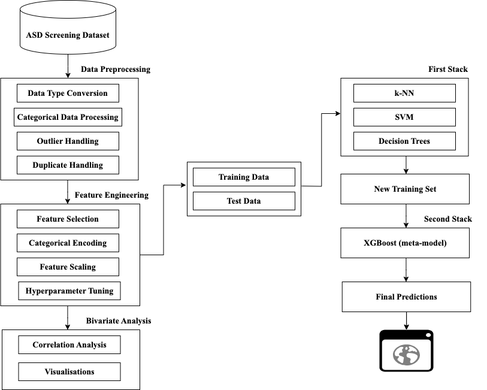
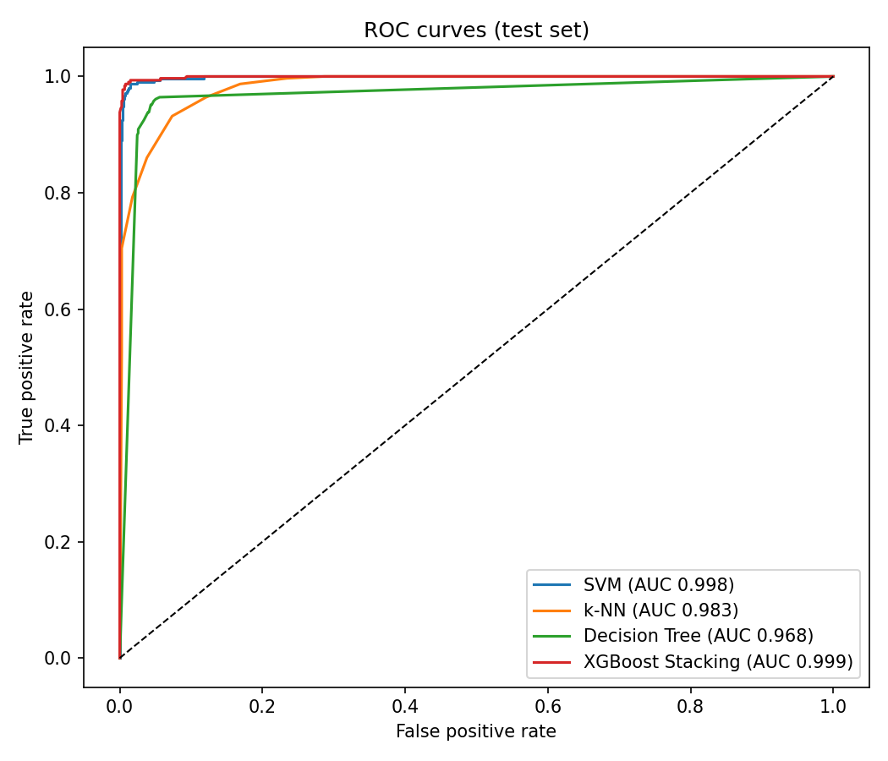

# ASD Detection System Using Stacking Ensemble Learning

A screening tool that estimates the likelihood of Autism Spectrum Disorder (ASD)
traits from the AQ-10 behavioural questionnaire and a few demographic fields.
It uses a two-level stacking ensemble: **SVM, k-NN and a Decision Tree** as base
learners, with an **XGBoost** meta-model on top. The project includes a Flask
REST API, a React web frontend and a Streamlit app.

**Live apps:**
- Streamlit: https://asd-detection-1-vd6fj3buv9eabjedhengnd.streamlit.app/
- React + Flask: *Vercel URL to be added once deployed*

Screening results are stored only when the user ticks the consent box
("stored anonymously … used for research"). Without consent, nothing is saved.

> **Disclaimer:** This is an academic project and a screening aid only. It is
> not a medical diagnosis. Anyone concerned about ASD should consult a qualified
> clinician.

This is the implementation for the final-year project *"Design and
Implementation of an Autism Spectrum Disorder (ASD) Detection System Using
Ensemble Learning"* (Yunusa Khadijah).

---

## Contents

1. [Results at a glance](#results-at-a-glance)
2. [System architecture](#system-architecture)
3. [Dataset](#dataset)
4. [Methodology](#methodology)
5. [Evaluation](#evaluation)
6. [Project structure](#project-structure)
7. [Getting started](#getting-started)
8. [API reference](#api-reference)
9. [Deployment](#deployment)
10. [Bug fixes in this revision](#bug-fixes-in-this-revision)
11. [Limitations and future work](#limitations-and-future-work)

---

## Results at a glance

Scores on the held-out test set (1,043 records, stratified 20% split, `random_state=42`):

| Model | Accuracy | Precision | Recall | F1 | ROC-AUC |
|---|---|---|---|---|---|
| SVM (RBF, C=10) | 0.986 | 0.984 | 0.968 | 0.976 | 0.998 |
| k-NN (k=9) | 0.928 | 0.842 | 0.932 | 0.884 | 0.983 |
| Decision Tree (depth 10) | 0.954 | 0.899 | 0.951 | 0.924 | 0.968 |
| **XGBoost stacking ensemble** | **0.989** | **0.981** | **0.984** | **0.982** | **0.999** |

Confusion matrix for the stacked model: 729 true negatives, 6 false positives,
5 false negatives and 303 true positives.

Run `python train.py` to reproduce these numbers. It writes them to
[`reports/metrics.json`](reports/metrics.json).



## System architecture



```
 Browser (React page)         ──POST /predict──►  Flask API (asd-backend/app.py)
 Streamlit app (app.py)       ──in-process────►  asd_core.predict()
                                                     │
                                                     ▼
                                     asd_detection2.pkl  (StackingClassifier)
                                     ├─ SVM  (Age scaling + SVC)
                                     ├─ k-NN (Age scaling + KNN)
                                     ├─ Decision Tree
                                     └─ XGBoost meta-model
                                                     │
                                                     ▼
                                     Supabase "predictions" table (optional)
```

## Dataset

`Autism_Dataset_Combined.csv` has **6,075 records**. It combines the UCI ASD
screening datasets (children, adolescents and adults) with a Kaggle autism
screening dataset.

| Column | Description |
|---|---|
| `A1` – `A10` | AQ-10 item scores (0/1). A point is scored for "agree" on items 1, 7, 8, 10 and for "disagree" on items 2, 3, 4, 5, 6, 9 |
| `Age` | Age in years (1–80) |
| `Sex` | `m` / `f` |
| `Jauundice` | Born with jaundice (`yes` / `no`). The misspelling is kept from the source data |
| `Family_ASD` | Family member with ASD (`yes` / `no`) |
| `Class` | Target: `YES` (ASD traits) / `NO` |

After cleaning, 5,211 records remain. 29.5% of them are ASD-positive.

## Methodology

All steps live in [`train.py`](train.py).

1. **Data preprocessing**
   - *Type conversion and categorical processing:* text values are lower-cased
     and stripped. `Sex`, `Jauundice`, `Family_ASD` and `Class` are mapped to 0/1.
   - *Duplicate handling:* 847 exact duplicate rows are removed. This happens
     **before** the split, so no record can appear in both the training and test sets.
   - *Outlier handling:* rows with an Age z-score of 3 or more (Age above about 66)
     are removed. That drops 17 rows.
2. **Bivariate analysis:** a correlation matrix and Random Forest feature
   importances (see `reports/figures/`).
3. **Train/test split:** 80/20, stratified on `Class`.
4. **First stack (base learners):** each model is tuned with 5-fold stratified
   `GridSearchCV`.
   - SVM: `C ∈ {0.1, 1, 10}`, `kernel ∈ {linear, rbf}`
   - k-NN: `k ∈ {3, 5, 7, 9}`
   - Decision Tree: `max_depth ∈ {3, 5, 10}`, `min_samples_split ∈ {2, 5, 10}`
   - *Feature scaling:* `Age` is standardised **inside** the SVM and k-NN
     pipelines. The tree needs no scaling. Because scaling lives inside each
     pipeline, every model gets the same input at prediction time as it did in
     training.
5. **New training set:** 5-fold *out-of-fold* `predict_proba` outputs of the
   three base learners. The meta-model therefore never learns from a prediction
   that a base model made on its own training rows, which avoids leakage.
6. **Second stack (meta-model):** XGBoost is tuned on those stacked
   probabilities (`n_estimators`, `learning_rate`, `max_depth`, `gamma`,
   `subsample`). Best: 200 trees, learning rate 0.01, depth 3, subsample 0.7.
7. **Final model:** everything is packaged as a single scikit-learn
   `StackingClassifier`. It is saved to `asd-backend/asd_detection2.pkl` with
   the feature order, encodings, metrics and library versions.

Formally, for base learners *h₁ (SVM), h₂ (k-NN), h₃ (DT)* and meta-learner *g*:

```
ŷ(x) = g( h₁(x), h₂(x), h₃(x) ),   hᵢ(x) = P̂ᵢ(ASD | x)
```

## Evaluation

| Figure | File |
|---|---|
| ROC curves | `reports/figures/roc_curves.png` |
| Precision–recall curves | `reports/figures/precision_recall_curves.png` |
| Confusion matrices (one per model) | `reports/figures/confusion_matrix_*.png` |
| Correlation matrix | `reports/figures/correlation_matrix.png` |
| Feature importance | `reports/figures/feature_importance.png` |



**How to read these numbers.** In the UCI AQ-10 datasets, the `Class` label
was produced by a scoring rule on the ten AQ items (for adults, a score above
6). A plain rule (`AQ score ≥ 7`) gets **94.3%** accuracy on the same test set
with no learning at all. The ensemble improves on that, mainly by learning the
different cut-offs in the child and toddler sub-datasets. Still, the very high
accuracies above say more about how consistent the label is with the AQ items
than about clinical diagnostic accuracy. See
[Limitations](#limitations-and-future-work).

## Project structure

```
ASD DETECTION/
├── train.py                  # Full training / evaluation pipeline (run this first)
├── app.py                    # Streamlit entry point (Home + Predict pages)
├── explore_page.py           # Streamlit: metrics and figures
├── predict_page.py           # Streamlit: questionnaire and prediction
├── requirements.txt          # Training + Streamlit dependencies (Streamlit Cloud)
├── packages.txt              # System packages for Streamlit Cloud
├── Autism_Dataset_Combined.csv
├── cleaned_dataset.csv       # Written by train.py
├── reports/
│   ├── metrics.json          # Written by train.py
│   └── figures/              # Written by train.py
├── asd-backend/              # Flask REST API
│   ├── app.py
│   ├── asd_core.py           # Shared feature definitions and inference
│   ├── asd_detection2.pkl    # Trained model (written by train.py)
│   ├── public/index.html     # React (CDN) web frontend
│   ├── requirements.txt
│   └── .python-version       # Python 3.12 for Vercel
├── render.yaml               # Render hosting for React + Flask
└── Procfile                  # Runs the Flask API on Heroku-style hosts
```

`train.csv` and `test.csv` are a separate Kaggle adult dataset. The current
pipeline does not use them.

## Getting started

Requires **Python 3.11 or 3.12**.

```bash
python3 -m venv .venv
```

```bash
source .venv/bin/activate
```

```bash
pip install -r requirements.txt
```

On macOS, XGBoost also needs OpenMP:

```bash
brew install libomp
```

### 1. Train the model (about 1 minute)

```bash
python train.py
```

### 2. Run the API and web frontend

```bash
cd asd-backend && python app.py
```

Open **http://127.0.0.1:5001**. Flask serves both the React page and the API.
It uses port 5001 because macOS's AirPlay Receiver already occupies port 5000.
Set a different port with `PORT=8080 python app.py` if needed.

To point the page at a different backend, add `?api=https://your-backend.example.com`
to the URL.

### 3. (Alternative) Run the Streamlit app

```bash
streamlit run app.py
```

### Optional: store predictions in Supabase

Create a `predictions` table with columns `A1`…`A10` (int), `Age` (int),
`Sex`, `Jaundice`, `Family_ASD`, `Prediction` (text). Then set:

```bash
export SUPABASE_URL="https://<project>.supabase.co" SUPABASE_KEY="<anon key>"
```

Without these variables the apps still work and simply skip saving. With
them, a result is saved only when the user ticks the consent box.

## API reference

### `POST /predict`

Request body. Each `A1`…`A10` value is the **scored** AQ-10 item (1 = the answer
that indicates the trait):

```json
{
  "A1": 1, "A2": 1, "A3": 0, "A4": 1, "A5": 1,
  "A6": 1, "A7": 1, "A8": 0, "A9": 1, "A10": 1,
  "Age": 25, "Sex": "m", "Jaundice": "no", "Family_ASD": "yes",
  "consent": true
}
```

`consent` is optional. The record is stored in Supabase only when it is `true`.

Response:

```json
{ "result": "ASD Positive", "probability": 0.904, "saved": true }
```

Invalid or missing fields return HTTP 400 with `{"error": "..."}`.

### `GET /`

Serves the React frontend (`asd-backend/public/index.html`).

### `GET /health`

Returns the API status, whether Supabase logging is on, and the library
versions the model was trained with.

## Deployment

Whichever host you use, the model pickle must be loaded with the **same
scikit-learn and XGBoost versions** it was trained with (pinned in
`asd-backend/requirements.txt` and `requirements.txt`). Retrain after any upgrade.

### Streamlit Community Cloud (recommended, free)

The repository is ready to deploy as-is: `app.py` and `requirements.txt` are at
the top level, and `packages.txt` installs the OpenMP library XGBoost needs.

1. Sign in at [share.streamlit.io](https://share.streamlit.io) with GitHub.
2. **Create app** → this repository, branch `main`, main file `app.py`.
3. Under *Advanced settings*, choose Python **3.12** and paste the secrets:
   ```toml
   SUPABASE_URL = "https://<project>.supabase.co"
   SUPABASE_KEY = "<anon key>"
   ```
   Streamlit Cloud exposes these as environment variables, which is how the app
   reads them. Without them the app still works and simply doesn't save.

Free apps sleep after about 12 hours without visitors. The next visitor wakes
the app with one click, which takes about 30 seconds.

### React + Flask on Vercel (free, no card needed)

Vercel runs the Flask API as a Python function and serves the React page from
`asd-backend/public/`.

1. Sign in at [vercel.com](https://vercel.com) with GitHub (Hobby plan).
2. **Add New → Project**, import this repository.
3. Set **Root Directory** to `asd-backend`. This matters: the top-level `app.py`
   is the Streamlit app, which Vercel cannot run.
4. Under **Environment Variables**, add `SUPABASE_URL` and `SUPABASE_KEY`, then
   **Deploy**.

Notes:
- Python functions on Vercel are limited to 500 MB. `asd-backend/requirements.txt`
  pins the 5 MB CPU-only XGBoost build on Linux; pip would otherwise choose the
  332 MB GPU build. The whole install is about 300 MB.
- `.python-version` selects Python 3.12, which the pinned numpy needs.
- After a quiet spell, the first prediction can take several seconds while
  the function starts and loads the model; later ones are fast.

### Render or Heroku

`render.yaml` (Render Blueprint) and the `Procfile` (Heroku) run
`gunicorn --chdir asd-backend app:app`. Render now asks for a card, even on
the free plan.

## Bug fixes in this revision

| # | Problem | Impact | Fix |
|---|---|---|---|
| 1 | The Decision Tree was trained on raw `Age`, but the Flask and Streamlit apps passed it the **standardised** `Age` | Stacked model accuracy in the live apps fell from about 98% to **74.7%**. The Decision Tree alone fell from 95.3% to 71.0% | Scaling now lives inside each model's pipeline, and the whole ensemble is one `StackingClassifier` |
| 2 | The XGBoost meta-model's hyperparameters were tuned on the 14 raw features, then the model was refit on the 3 stacked probabilities | The tuning did not apply to the meta-model that was actually used | XGBoost is now tuned on the out-of-fold stacked probabilities |
| 3 | Frontend instructions said "Yes = disagree" for items 2–6 and 9, but the code scored "No" as the trait answer on those items | Users who followed the instructions got the reverse score on 6 of the 10 items | Buttons are now **Agree / Disagree**, with AQ-10 scoring done in code |
| 4 | `asd-backend/requirements.txt` was a full Anaconda `pip freeze` with local `file:///` paths | `pip install` and cloud builds failed | Replaced with a minimal pinned list |
| 5 | Supabase URL and key were hard-coded in `app.py`, and any database error crashed `/predict` | Credentials were exposed in git, and a database outage broke predictions | Read from environment variables; logging is optional and its errors are caught |
| 6 | `/predict` had no input validation | A missing field gave a `KeyError` (HTTP 500) | Validation returns HTTP 400 with a clear message |
| 7 | The API ran on port 5000 | On macOS, AirPlay Receiver answers on 5000 with HTTP 403, so the frontend could not connect | Default port is now 5001, configurable with `PORT` |
| 8 | Training logic was copied, with differences, across `asd.py`, `Test.py`, `autism.py` and `explore.py` | Results were hard to reproduce, and the saved model depended on which script ran last | One `train.py` replaces them (the old scripts remain in git history) |
| 9 | Unpinned React CDN builds (`react@18`, development build) | Behaviour could change without notice, and the development build is slower | Pinned to `react@18.3.1` production builds |

> **Security note:** the old Supabase anon key is still in this repository's
> git history. If the `predictions` table allows public reads or writes,
> rotate the key in the Supabase dashboard.

## Limitations and future work

- **Label circularity:** the dataset labels come largely from AQ-10 score
  thresholds, so the model mostly learns that rule. External validation
  against clinical diagnoses is needed before any claim of diagnostic accuracy.
- **Mixed populations:** toddler, child, adolescent and adult questionnaires
  use different items and cut-offs, but they are merged under the same
  `A1`–`A10` columns.
- **Self-report bias:** the answers are self-reported or reported by a parent.
- **Future work:** clinical and multi-modal data, local-language versions for
  the Nigerian context, a mobile app, probability calibration, and SHAP
  explanations for individual predictions.

## Acknowledgements

Datasets: UCI Machine Learning Repository (Thabtah, F., *Autism Screening
Adult / Child / Adolescent*) and the Kaggle autism screening datasets.
Supervisor: Dr (Mrs) Tope Oke.
